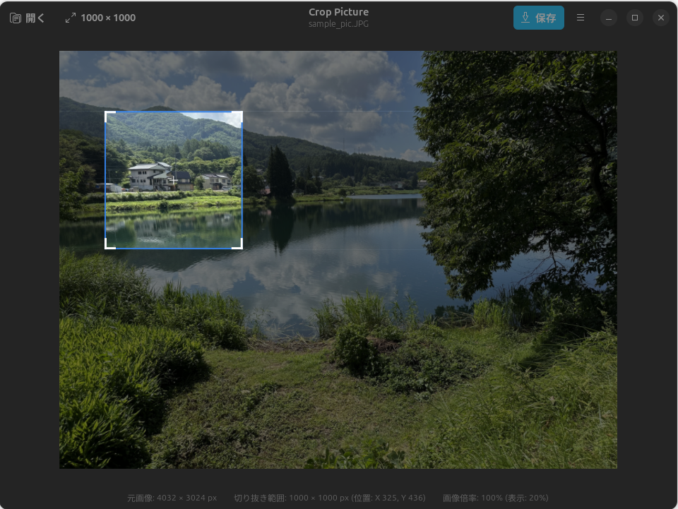
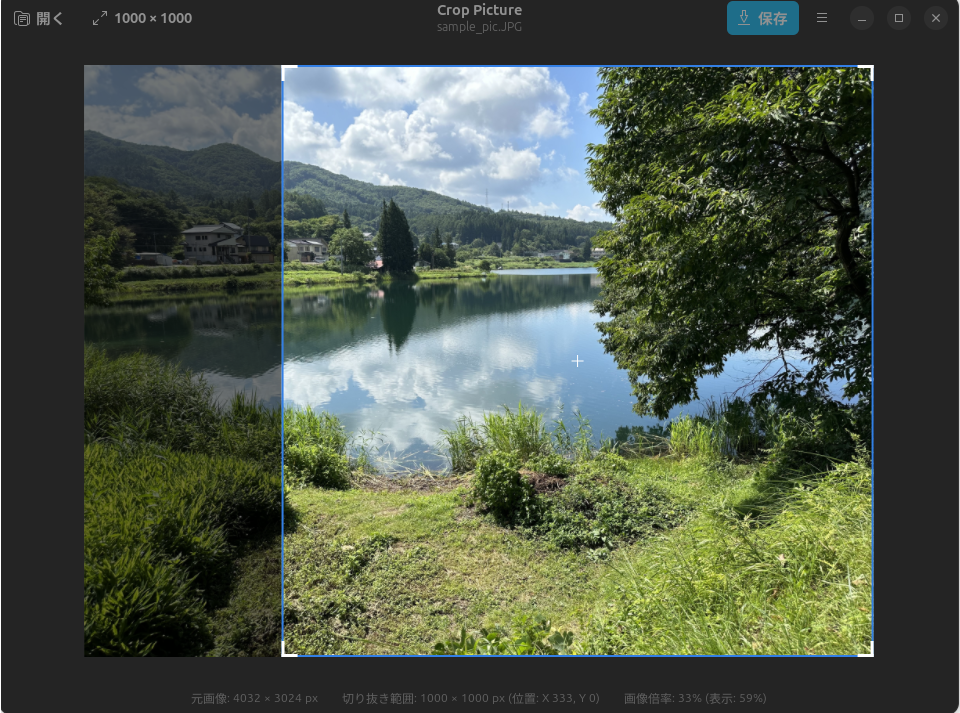
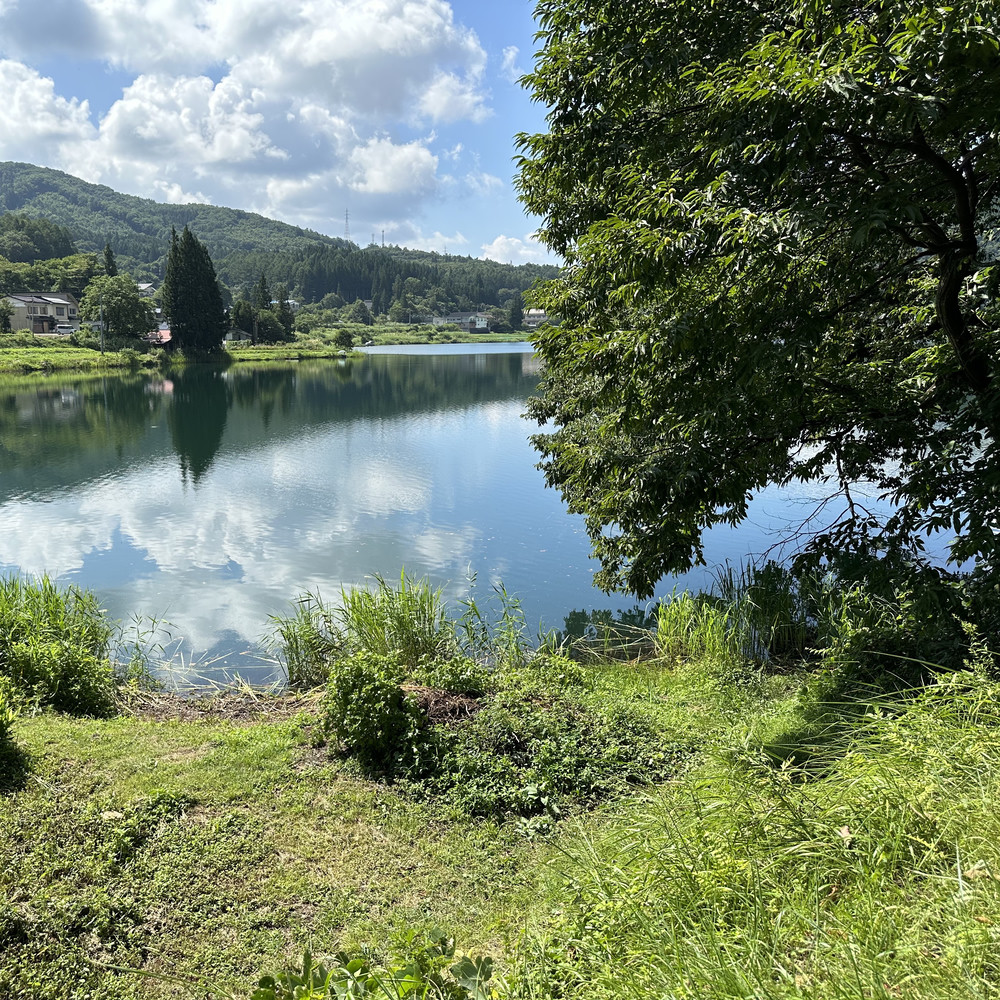

# Crop Picture

GNOME Desktop 向けのネイティブ画像切り抜きツールです。Libadwaita と GTK4 を採用し、直感的な操作感と美しいデスクトップ統合を提供します。

---

## アプリ概要

**Crop Picture** は、Web 制作や SNS 投稿で頻繁に利用される画像フォーマット（JPEG, PNG, WebP, GIF, BMP, TIFF）を読み込み、指定した寸法（正方形・長方形）で美しく正確に切り抜いて書き出すことができるデスクトップアプリケーションです。

| 元画像表示 | 切り抜き | 元画像表示 (切り抜き範囲をそのままに元画像を相対的に縮小) | 拡大切り抜き |
| :---: | :---: | :---: | :---: |
|  |  |  |  |

上の例では、切り抜かれた画像はどちらも1000x1000pixelのサイズになっています。

### 主な特徴

- **自由な切り抜きサイズ指定（正方形・長方形対応）**:
  - デフォルトの 1000×1000 px をはじめ、SNS の OGP（1200×630）、スマートフォンの縦長ストーリー（1080×1920）、16:9 や 4:3 などの長方形、100〜10,000 px の自由なピクセル寸法を簡単に設定できます。
  - アスペクト比固定ロック機能により、縦横比を保ったままのサイズ変更もワンタッチです。
- **画像の拡大縮小による構図調整**:
  - マウスホイールや `PageUp`/`PageDown` キーで画像を拡大・縮小し、切り抜く範囲の広狭（寄った構図／引いた構図）を自由に調整できます。
  - 拡大縮小時も高品質リサンプリング（Lanczos3）により、指定したピクセルサイズ厳密に出力されます。
- **直感的な操作性**:
  - マウスドラッグによる移動に加え、キーボードの矢印キーによる 1px 単位の精密な位置調整、`Shift`+矢印キーによる高速移動に対応しています。
- **GNOME HIG 完全準拠**:
  - Libadwaita を採用。ダーク/ライトテーマ、システムアクセントカラー、ウィンドウサイズに応じたアダプティブ UI に完全連動します。
- **GPU 支援高速描画 (GSK)**:
  - GTK4 Scene Kit (GSK) による GPU レンダリングを行い、高解像度画像でも軽快にプレビュー表示・ドラッグ操作が可能です。
- **EXIF Orientation 完全対応**:
  - スマートフォンやデジタルカメラで撮影された写真の回転・反転情報を自動補正した上で切り抜き処理を行います。
- **デスクトップ統合と使いやすさ**:
  - 前回開いたフォルダおよび前回保存したフォルダを自動記憶（GSettings）。
  - 画像保存完了時の通知から「フォルダを開く」を押すと、ファイルマネージャーで保存した画像が選択された状態で直接開きます。
- **マルチアーキテクチャ対応**:
  - ARM64 (`aarch64`) および x86_64 (`amd64`) の双方に対応した Debian パッケージ (`.deb`) を生成・インストール可能です。

---

## 使用方法

### 1. 画像を開く
- ヘッダーバー左側の **「開く」** ボタンをクリックするか、ショートカットキー **`Ctrl + O`** を押します。
- または、画像ファイルをウィンドウ上に直接 **ドラッグ＆ドロップ** することでも読み込めます。
- 対応フォーマット: JPEG, PNG, WebP, GIF, BMP, TIFF

### 2. 切り抜きサイズを設定する
- ヘッダーバー中央の **サイズ表示ボタン**（例: `1000 × 1000`）をクリックすると、設定ポップオーバーが開きます。
  - **プリセット**:
    - `1000 × 1000` (正方形)
    - `1200 × 630` (SNS OGP / 横長長方形)
    - `1080 × 1920` (ストーリー / 縦長長方形)
    - `800 × 600` (4:3)
    - `1920 × 1080` (16:9 フルHD)
  - **数値直接入力**: 幅（Width）と高さ（Height）をスピンボタンで 100 〜 10,000 px の範囲で自由に変更できます。
  - **アスペクト比固定トグル**: リンクアイコンのボタンを有効にすると、現在の比率を維持したまま幅・高さが連動して変化します。

### 3. 構図と位置を調整する
- **画像の拡大・縮小（ズーム）**:
  - マウスホイールを上下に回転、または **`PageUp` / `PageDown`** キーを押します。
  - 拡大すると切り抜く範囲が狭くなり（寄った構図）、縮小すると切り抜く範囲が広くなります（引いた構図）。
- **切り抜き枠の移動**:
  - **マウス操作**: 枠の内側をドラッグして希望の位置へ移動します。
  - **キーボード微調整**: 矢印キー（`↑`, `↓`, `←`, `→`）で 1 px 単位で移動します。`Shift` キーを押しながら矢印キーを押すと 10 px ずつ素早く移動します。

### 4. 切り抜いた画像を保存する
- ヘッダーバー右側の **「保存」** ボタンをクリックするか、ショートカットキー **`Ctrl + S`** を押します。
- 保存先ダイアログが表示されるので、ファイル名と保存先を指定します。
  - デフォルトのファイル名は `{元ファイル名}_crop{幅}x{高さ}.{拡張子}` に自動設定されます。
  - ファイルの拡張子（`.png`, `.jpg` / `.jpeg`, `.webp`）に応じて自動的に適切なフォーマットでエンコードされます。
- 保存が完了すると画面下部に通知（トースト）が表示されます。**「フォルダを開く」** ボタンを押すと、保存したファイルが選択された状態でファイルマネージャーが起動します。

---

## キーボードショートカット一覧

| ショートカット | 動作 |
| :--- | :--- |
| `Ctrl + O` | 画像ファイルを開く |
| `Ctrl + S` | 切り抜いて保存する |
| `Ctrl + ?` | キーボードショートカット一覧を表示 |
| `Ctrl + W` | ウィンドウを閉じる |
| `Ctrl + Q` | アプリケーションを終了する |
| `PageUp` / マウスホイール上 | 画像を拡大（切り抜き範囲を狭く） |
| `PageDown` / マウスホイール下 | 画像を縮小（切り抜き範囲を広く） |
| 矢印キー（`↑`, `↓`, `←`, `→`） | 切り抜き枠を 1 px 移動 |
| `Shift` + 矢印キー | 切り抜き枠を 10 px 移動 |

---

## ビルド・インストール手順

### 必要環境
- Linux (Wayland または X11, GNOME 46 推奨)
- Rust 1.80 以上
- GTK 4 (>= 4.14)
- Libadwaita (>= 1.5)

### 1. 依存パッケージのインストール (Ubuntu / Debian)
```bash
sudo apt update
sudo apt install -y build-essential libgtk-4-dev libadwaita-1-dev
curl --proto '=https' --tlsv1.2 -sSf https://sh.rustup.rs | sh
source "$HOME/.cargo/env"
```

### 2. Debian パッケージ (.deb) のビルドとインストール
`cargo-deb` を使用してシステム用の `.deb` パッケージを生成・インストールできます。

```bash
# cargo-deb ツールのインストール (初回のみ)
cargo install cargo-deb

# Debian パッケージの生成
cargo deb

# パッケージのインストール
sudo dpkg -i target/debian/crop-picture_*.deb
```
インストール後は、デスクトップのアプリケーション一覧（ランチャー）から「Crop Picture」を起動できます。

### 3. ソースコードから直接実行する場合
```bash
# 開発デバッグ実行
cargo run

# テストの実行
cargo test
```

### 4. アンインストール
```bash
sudo apt remove crop-picture
```

---

## プロジェクト構成

```text
crop-picture/
├── Cargo.toml                         # パッケージメタデータおよび依存関係設定
├── data/
│   ├── org.example.CropPicture.desktop        # デスクトップエントリ
│   ├── org.example.CropPicture.metainfo.xml   # AppStream メタデータ
│   ├── org.example.CropPicture.gschema.xml    # GSettings スキーマ (設定永続化)
│   └── icons/                                 # アプリアイコン (scalable SVG, symbolic SVG)
├── debian/scripts/                    # deb パッケージ用メンテナスクリプト
├── src/
│   ├── main.rs                        # エントリポイント
│   ├── config.rs                      # アプリケーション定数
│   ├── application.rs                 # AdwApplication およびアクション登録
│   ├── window.rs                      # AdwApplicationWindow (ヘッダーバー、ポップオーバー、ダイアログ制御)
│   ├── crop_canvas.rs                 # カスタム描画ウィジェット (GSK レンダリング、ジェスチャー処理)
│   ├── crop_state.rs                  # 座標計算・クランプ・拡大縮小の純粋幾何ロジック
│   └── image_processor.rs             # 画像デコード、EXIF Orientation、プレビュー生成、リサンプリング切り抜き保存
└── tests/                             # 単体・結合テスト
```

---

## ライセンス・謝辞

- **ライセンス**:本プロジェクトは MIT ライセンスまたは Apache License 2.0 の下で公開されています。
- **AI 支援**: 本アプリケーションのコード作成には Gemini (Gemini 3.8 Flash Medium) が用いられています。